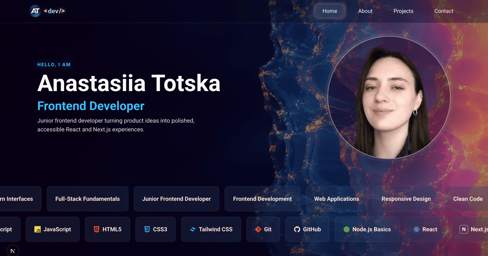
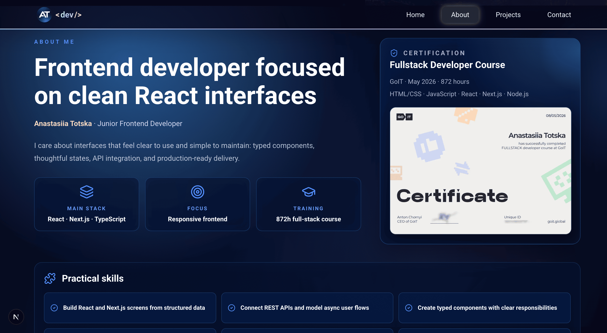
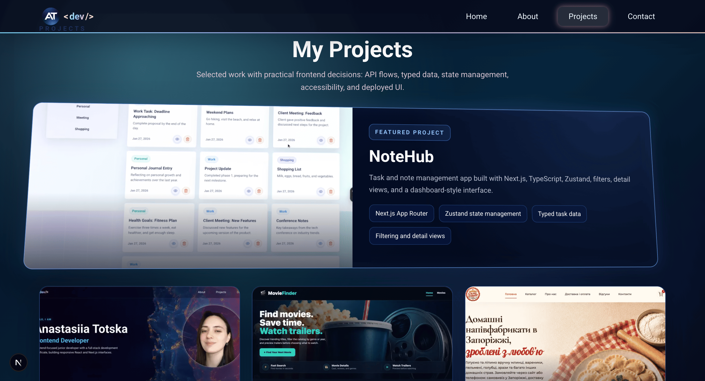

# Anastasiia Totska Portfolio

Personal portfolio for a junior frontend developer. The site presents my profile, practical skills, selected projects, downloadable CVs, and contact links in one responsive page.

## Live Demo

[View the deployed app](https://anastasiia-totska-github-io.vercel.app/)

## Preview

### Hero Section



### About Section



### Projects Section



## Stack

| Technology    | Purpose                                  |
| ------------- | ---------------------------------------- |
| Next.js       | App Router, metadata, image optimization |
| React         | Component-based UI                       |
| TypeScript    | Typed project data and component props   |
| CSS Modules   | Scoped, mobile-first styles              |
| Framer Motion | Small section and modal animations       |
| Vercel        | Deployment                               |

## Main Features

- Fixed header with active section state and smooth anchor navigation.
- Hero section with skill marquees and visible technology icons.
- About section with certificate, practical skills, and CV downloads.
- Project cards generated from typed data in `data/projectsData.ts`.
- Project details modal with scroll locking and Escape key close.
- Contact section built with accessible links.
- Global scroll-reactive gradient background.
- SEO metadata and social previews through the Next.js Metadata API.
- Image optimization with `next/image`, font optimization with `next/font`, and a dynamically imported skills marquee.

## Featured Project Technologies

The project descriptions and technology tags reflect the source code of each app:

- **MovieFinder:** React, JavaScript, Vite, React Router, Axios, and the TMDB API. Routes use `React.lazy` and `Suspense`; movie and cast images load lazily. Vitest and React Testing Library cover search, filters, pagination, and movie cards. GitHub Actions runs lint, tests, and a build; deployment uses the Vercel Git integration independently of CI.
- **NoteHub:** Next.js App Router, TypeScript, TanStack Query, Zustand, Axios, and CSS Modules. React Query caches remote notes and invalidates queries after mutations. Zustand persist saves note drafts in localStorage. Search is debounced, and notes support filters, pagination, and route-based modal previews.
- **sama-zlipula:** React, TypeScript, Vite, Context API, and CSS Modules. The storefront includes a catalog, cart, admin interface, Supabase REST integration, and Telegram order notifications through a Vercel serverless endpoint. It implements canonical metadata, Open Graph, JSON-LD, a sitemap, and lazy-loaded product images.
- **Portfolio:** Next.js, React, TypeScript, CSS Modules, and Framer Motion, with DE/EN/UA content, optimized images, SEO metadata, and language-specific CV downloads.

The skills section also includes Figma and OpenAI Codex for design implementation and AI-assisted development. SEO, performance optimization, and CI/CD describe practical techniques used in the projects; they do not imply measured performance gains or advanced specialization.

## Project Structure

```text
app/                  Next.js app entry, metadata, global styles
components/           Reusable UI and behavior helpers
data/                 Typed content used by sections
sections/             Page sections: Header, Hero, About, Projects, Contact
types/                Shared TypeScript interfaces
public/               Images, videos, CV files, favicon
```

## Scripts

```bash
npm install
npm run dev
npm run lint
npm run build
```

Open http://localhost:3000 after `npm run dev`.

## Validation

Run `npm run lint` and `npm run build` before publishing. The layout uses mobile-first CSS Modules, typed project data, and reusable components. The GitHub Actions workflow described above belongs to MovieFinder.

## Author

Anastasiia Totska

- GitHub: https://github.com/Anastasiia-git
- LinkedIn: https://linkedin.com/in/anastasiia-totska
